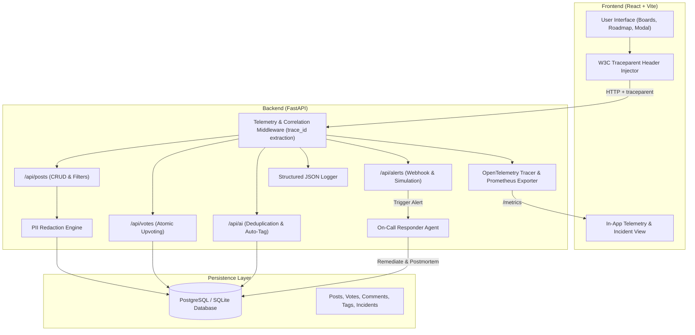
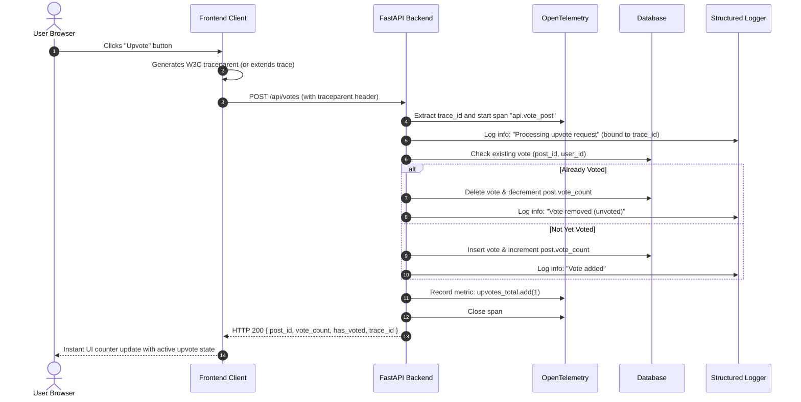

# FeaturePulse — System Architecture & Design

> **Evaluation Rubric Reference**: Criterion 4 (Context Management) & Criterion 5 (Application Architecture)

---

## 1. System Overview

FeaturePulse is an end-to-end feedback intelligence platform featuring:
- **Frontend**: Single-Page Application built with React 18, TypeScript, and Tailwind CSS.
- **Backend API**: High-performance asynchronous API built with FastAPI (Python 3.11/3.12).
- **Persistence Layer**: SQLAlchemy ORM with support for SQLite (zero-config local run) and PostgreSQL (production/docker-compose).
- **AI Deduplication**: Semantic text matching and n-gram similarity engine for real-time duplicate feedback detection.
- **Telemetry Layer**: OpenTelemetry tracing, Prometheus metrics exporter (`/metrics`), and JSON structured logger with automatic PII masking.
- **Autonomous On-Call Agent**: Webhook receiver that ingests alert triggers, queries recent telemetry traces, applies auto-remediation, and generates markdown incident postmortems.

---

## 2. Architecture Diagram

---

## 3. Data Models (Entity-Relationship)

### `Post`
- `id`: Integer (Primary Key)
- `title`: String(255) (Indexed)
- `description`: Text (PII-sanitized)
- `category`: String(50) (e.g. `UI/UX`, `Performance`, `Integrations`, `Core Feature`, `Bug`)
- `status`: String(30) (`open`, `under_review`, `planned`, `in_progress`, `completed`)
- `vote_count`: Integer (Default: 1, Indexed)
- `author_id`: String(100) (Anonymous client hash or user handle)
- `created_at`: DateTime (UTC)
- `updated_at`: DateTime (UTC)

### `Vote`
- `id`: Integer (Primary Key)
- `post_id`: Integer (Foreign Key -> `Post.id`, Cascading Delete)
- `user_id`: String(100) (Client session ID)
- `created_at`: DateTime (UTC)
- *Unique Constraint*: `(post_id, user_id)` guarantees idempotent 1 vote per user per post.

### `Comment`
- `id`: Integer (Primary Key)
- `post_id`: Integer (Foreign Key -> `Post.id`)
- `author_id`: String(100)
- `content`: Text (PII-sanitized)
- `created_at`: DateTime (UTC)

### `Incident`
- `id`: Integer (Primary Key)
- `alert_name`: String(100)
- `severity`: String(20) (`warning`, `critical`)
- `status`: String(20) (`firing`, `investigating`, `resolved`)
- `symptoms`: Text
- `root_cause`: Text
- `remediation_action`: Text
- `trace_id`: String(64)
- `postmortem_md`: Text
- `created_at`: DateTime (UTC)

---

## 4. Key User Journey: Trace-Correlated Upvoting

---

## 5. Security & PII Protection Policy

- **No Secrets in Telemetry**: Database credentials, tokens, and authorization headers are scrubbed at the logging and tracing middleware boundary.
- **PII Scrubbing**: Free-form text fields (feedback description, comments) are passed through an automated regular expression sanitizer that strips:
  - Email addresses (e.g., `user@domain.com` ➔ `[REDACTED_EMAIL]`)
  - Phone numbers (e.g., `+1-555-0199` ➔ `[REDACTED_PHONE]`)
  - API keys and tokens (e.g., `sk_live_...` ➔ `[REDACTED_KEY]`)
- **Anonymous Session Identifiers**: Client identities are hashed or stored as opaque session UUIDs.
