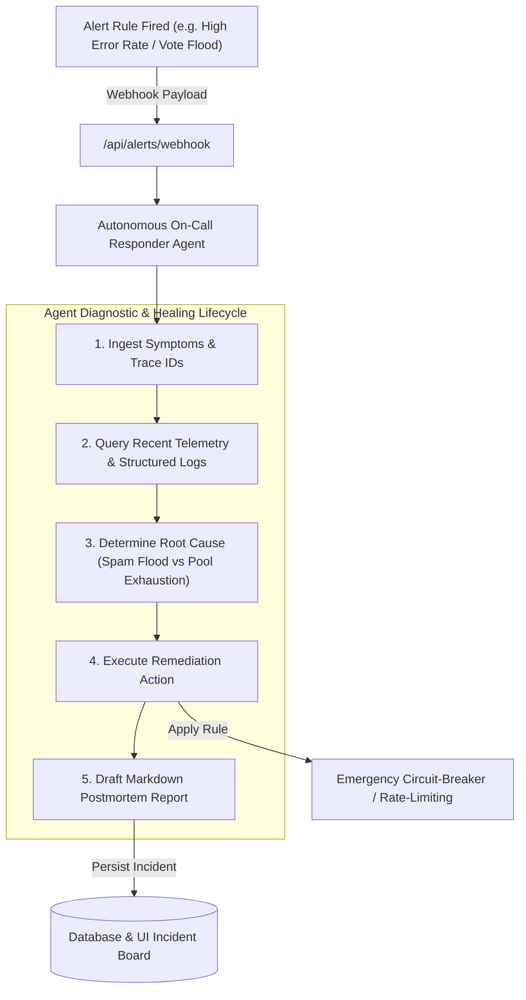

# FeaturePulse — Alerting & On-Call Responder Agent Runbook

> **Evaluation Rubric Reference**: Criterion 11 (Alerting on User Impact) & Criterion 12 (On-Call Agent)

---

## 1. Alerting on Real User Impact

In accordance with course guidelines, alerts are tied to **real user impact** (error rates, request failures, and service degradation) rather than abstract CPU graphs.

### Defined Alerts

#### Alert 1: `HighVotingErrorRateAlert`
- **Symptom / Impact**: Users clicking "Upvote" receive HTTP 5xx errors or connection timeouts.
- **Trigger Condition**: Error rate on `POST /api/votes` exceeds $5\%$ over a 1-minute window, or $> 10$ consecutive voting failures.
- **Severity**: `CRITICAL`
- **User Impact**: Inability for users to vote or engage with feedback items.

#### Alert 2: `VotingVelocityAnomalyAlert` (Vote Flood / Spambot)
- **Symptom / Impact**: An automated script or spam attack generates $> 50$ votes/second from one or a cluster of client sessions, threatening DB connection exhaustion.
- **Trigger Condition**: Voting velocity $> 50$ votes/sec on a single post or from single IP block.
- **Severity**: `WARNING`
- **User Impact**: Roadmap distortion, platform degradation for genuine users.

---

## 2. On-Call Responder Agent Architecture

When an alert triggers, it dispatches a webhook payload to `/api/alerts/webhook`. The **Autonomous On-Call Responder Agent** (`app/agent/oncall.py`) wakes up to triage and heal the system.



---

## 3. Automated Remediation Capabilities

The On-Call Agent executes deterministic and safe auto-remediations:

1. **Emergency Vote Rate Limiter Activation**:
   - If a vote flood or lock contention is diagnosed, the agent dynamically enables strict per-IP rate limiting (e.g., maximum 5 votes per minute per client).
2. **Database Connection Pool Reset**:
   - If connection timeouts or transaction deadlocks are observed, the agent flushes idle pool connections and clears stale connection locks.
3. **Quarantine Offending Client/IP**:
   - If anomalous high-velocity requests are isolated to a single client identifier or IP, that client is quarantined into a temporary shadow-ban list.
4. **Automated Incident Postmortem**:
   - Produces a comprehensive markdown incident report detailing:
     - Incident ID & Timestamps
     - Triggering Alert & Severity
     - Correlated Trace ID
     - Root Cause Analysis
     - Remediation Action Taken
     - Verification / Health Status

---

## 4. Testing & Simulating the Alert & On-Call Agent

You can trigger a simulated alert and observe the On-Call Responder Agent wake up in real time:

### Via API:
```bash
curl -X POST http://localhost:8000/api/alerts/simulate \
  -H "Content-Type: application/json" \
  -d '{"alert_type": "high_error_rate", "severity": "critical"}'
```

### Via Frontend UI:
1. Navigate to the **"Incidents & Alerting"** tab in the navigation bar.
2. Click **"Simulate High Error Rate Alert"** or **"Simulate Spambot Voting Flood"**.
3. Watch the On-Call Agent wake up, parse the correlated trace, execute the remediation, and post the markdown postmortem to the incident log.
